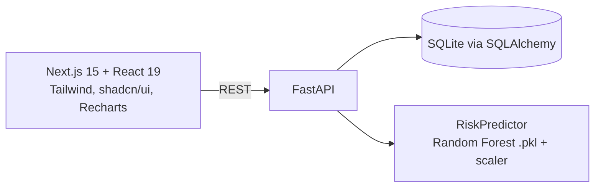

<div align="center">

# 🏦 ALM Bank — Client Risk Dashboard & Default Prediction

**A full-stack banking app: manage clients, visualise portfolio risk and predict the default risk of a loan applicant with a Random Forest model.**


</div>

---

## Overview

Credit officers need to see where risk sits in a client portfolio and to score a new applicant quickly. This project provides:

- a **client management** screen (add, view, edit, delete, filter);
- a **risk analysis dashboard** (distribution, trends, KPIs) with filters;
- a **risk simulator** that predicts whether a client is likely to default, from financial attributes.

## Features

| Area | What you can do |
|---|---|
| Client management | CRUD on clients, search and filters, risk badges |
| Risk dashboard | Risk distribution, trend charts (Recharts), summary indicators |
| Risk simulation | Enter income, credit card balance, loans, savings, properties owned and get a default-risk prediction |
| ML model | Random Forest classifier loaded by the API (`backend/ml_model/predict.py`) |

## Architecture



| Endpoint | Method | Purpose |
|---|---|---|
| `/api/clients` | `POST` | Create a client and return the predicted default risk |
| `/api/banking` | `GET` | Dashboard data: distribution, trends, indicators (filterable) |
| `/` | `GET` | Health message |

Interactive docs: `http://localhost:8000/docs` once the API is running.

## Tech stack

| Layer | Tools |
|---|---|
| Frontend | Next.js 15, React 19, TypeScript, Tailwind CSS, Radix UI / shadcn/ui, Recharts |
| Backend | Python, FastAPI, SQLAlchemy 2, Pydantic |
| ML | scikit-learn, imbalanced-learn, pandas, NumPy |
| Data | `backend/Banking.csv` (structured client records) |

## Getting started

**Prerequisites:** Python 3.11+, Node.js 18+.

```bash
# Backend
cd backend
python -m venv .venv && source .venv/bin/activate      # Windows: .venv\Scripts\activate
pip install -r requirements.txt
python populate_db.py                                   # first run: builds banking.db from the CSV
uvicorn main:app --reload --port 8000
```

```bash
# Frontend (new terminal)
cd frontend
npm install
npm run dev                                             # http://localhost:3000
```

The SQLite database (`banking.db`) is not versioned: `populate_db.py` generates it locally.

## Project structure

```
alm_bank/
├── backend/
│   ├── main.py            FastAPI app and endpoints
│   ├── models.py, crud.py, database.py   SQLAlchemy layer
│   ├── ml_model/          RiskPredictor + trained Random Forest
│   ├── populate_db.py     loads Banking.csv into the database
│   └── Banking.csv        client dataset
└── frontend/
    ├── app/               pages: dashboard, client-management, risk-analysis, risk-simulation
    └── components/        dialogs, tables, risk widgets, simulators, ui kit
```

## Known issues and roadmap

- [ ] `clients-management.tsx` calls port `5000` while the API runs on `8000`: move the base URL to an environment variable.
- [ ] Report model metrics (AUC, F1, recall) and the training notebook in the repo.
- [ ] Authentication for credit officers, PDF export of predictions.
- [ ] Tests for the API and the predictor.

## Author

**Atef Ben Hadef**: [GitHub](https://github.com/atef-hadef) · [LinkedIn](https://linkedin.com/in/atef-ben-hadef)
